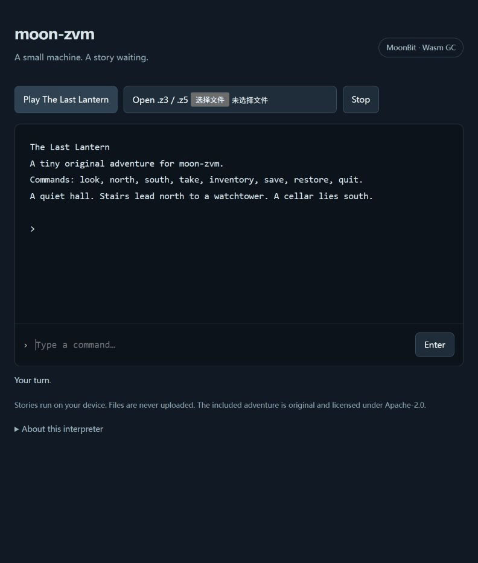

# moon-zvm

A Z-machine v3/v5 interpreter written in MoonBit. The interpreter core has no FFI or external package dependencies. Terminal file access is a small Node.js host; the browser host runs the same core as Wasm GC.



## Try an adventure

Install MoonBit (moonc 0.10.16 or newer) and Node.js 22.3 or newer. From this directory:

```sh
moon run cmd/main --target js -- examples/lantern.z5
```

The included original adventure, **The Last Lantern**, takes a few commands to finish:

```
north
take
south
south
quit
```

`look`, `inventory`, `save`, and `restore` also work. Save and restore prompt for a local Quetzal filename. A `.z3` build is included as well. The command-line host is a plain transcript interface; it does not emulate terminal cursor positioning. It exits with a nonzero status on execution errors.

To play a raw story file you own, replace the example path with its `.z3` or `.z5` path. Games are not fetched or bundled automatically.

## Browser

```sh
node tools/build-web.mjs
python -m http.server 8000 --directory dist
```

Open http://localhost:8000 and choose **Play The Last Lantern**, or load your own story. The browser needs Wasm GC and JS string builtins. It provides a fixed-width upper window, a lower transcript, local story loading, save downloads and save restoration. Files stay on the device.

## Embed the core

Import the root package `aa-11aa/moon-zvm` with an alias such as `@zvm`. A registry release is not yet available; use this checkout to run the examples and tests.

```moonbit
let machine = @zvm.Machine::new(story_bytes)
let state = machine.run(budget=20000)
let text = machine.take_output()
```

`run` returns `"budget"`, `"line"`, `"char"`, `"save"`, `"restore"`, or `"halted"`. A host drains `take_output()`, displays `upper_window()`, and responds to requests:

| State | Host action |
| --- | --- |
| `budget` | Schedule another slice; allow cancellation between slices |
| `line` | `send_line(command)` |
| `char` | `send_char(zscii_code)` |
| `save` | Persist `save_data()`, then call `finish_save(success)` |
| `restore` | `restore_data(bytes)`, or `cancel_restore()` |
| `halted` | Stop execution |

Invalid stories, unsupported instructions and execution faults raise `Invalid(String)`. `position()` gives the current PC; runtime error messages include the instruction address. A rejected save leaves the pending restore intact so the host can retry or cancel. The interpreter enforces instruction, call-stack, evaluation-stack, abbreviation-depth and buffered-output limits.

## Implemented

- Raw v3/v5 headers, big-endian dynamic/static memory, 16-bit arithmetic.
- Long, short, variable and extended instruction encodings; routine calls, arguments, locals, globals and evaluation stacks.
- Comparisons, branches, signed arithmetic, indirect variables, object trees, attributes and variable-size properties.
- Z-encoded strings, abbreviation tables, custom alphabets and ZSCII output.
- ASCII line input, dictionary encoding, lexical analysis, character input and memory output streams (including nesting).
- Fixed 80×25 split window, upper-window cursor positioning and erasure, lower transcript output.
- Sixteen levels of undo; Quetzal IFZS files with IFhd, UMem and Stks output, and CMem/UMem input.
- Restart, checksum verification, table operations and catch/throw.

## Boundaries

This project does **not** claim full Standard 1.1 conformance. The header deliberately reports standard revision 0.0. Czech and Praxix check many execution details, but do not establish complete screen or game compatibility.

- Supported story versions: **3 and 5 only**. No Blorb extraction, v6 graphics or sound.
- Line input is printable ASCII. ZSCII output supports the standard accented-character table and v5 Unicode translation tables. Timed input is unavailable.
- The hosts offer plain text. Colour, bold/italic styles, font 3, pictures, mouse, external transcripts, command recording and auxiliary files are not advertised. Font 1 and fixed font 4 are available; unsupported fonts return 0.
- v3 reports that it cannot display the automatic status line. The upper-window API is for explicit split-window output.
- Random numbers use a deterministic 16-bit PRNG. This is useful for reproducible execution and is not a source of entropy.
- Quetzal exchange has been tested in both directions with Dumb Frotz 2.44 using the original v3/v5 adventure. This does not establish compatibility with every interpreter or every save file.
- The core is intended for JS, Wasm GC, Wasm and native. The CLI is Node.js only. Native tests run in Linux CI; Windows needs MSVC Build Tools and the Windows SDK.

## Verify

```sh
moon check --target all --deny-warn
moon test --target js
moon test --target wasm-gc
moon test --target wasm
moon test --target native
moon info
moon fmt --check
python tools/conformance.py
python tools/conformance.py --praxix
node tools/build-web.mjs
node tools/verify-wasm.mjs
node tools/verify-player.mjs
# Optional independent interpreter, installed separately:
python tools/interop.py --dfrotz /path/to/dfrotz
```

The story runner checks Czech **v3: 349 passed / 0 failed** and **v5: 406 passed / 0 failed**. Each additionally prints 19 visual checks, which are **not** counted as automated passes. The optional Praxix runner downloads a hash-pinned story from its author's repository (with archive mirrors as fallbacks), feeds `all` / `quit`, and checks its automatic summary; Standard 1.1 colour and Standard 1.2 capability groups are skipped. Transcripts are saved under ignored `test-results/`.

The original adventure is tested in both v3 and v5 with navigation, inventory and a save/restore round trip. `verify-wasm.mjs` repeats an adventure through the actual browser Wasm exports. MoonBit tests additionally exercise malformed headers, every first-byte opcode, truncated saves, arithmetic, stack semantics and input suspension.

`verify-player.mjs` tests the browser host's asynchronous request ordering with mocks: stopped restores cannot restart a game, older downloads cannot replace a newer story, oversized files are rejected before reading, and rejected commands remain available for correction. These controller checks supplement the interpreter tests; they are not a substitute for browser UI testing.

## References and licensing

The runtime was implemented from [The Z-Machine Standards Document 1.1](https://inform-fiction.org/zmachine/standards/current/index.html) and [Quetzal 1.4](https://ifarchive.org/if-archive/infocom/interpreters/specification/savefile_14.txt). No Frotz or other interpreter source was used or ported.

Runtime and original examples: **Apache-2.0** (see `LICENSE`). Third-party test stories retain their own license notices; see [`fixtures/SOURCES.md`](fixtures/SOURCES.md). Inform 6 compiles the original demonstration story and the v3 Czech test; Inform is not a runtime dependency. [Frotz](https://ifarchive.org/indexes/if-archive/infocom/interpreters/frotz/) (GPL-2.0) is used only as an optional external behavior/save-format reference; neither its executable nor its source is included in the module. Proprietary game files, including Zork, are not distributed here.
